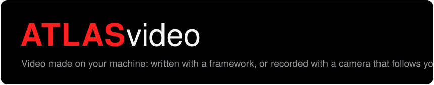
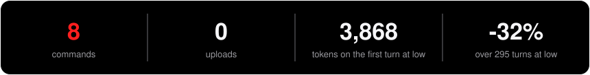

<p align="center"></p>
<p align="center"></p>

**Ask your coding agent for a demo video, and get one, with nothing uploaded.** Everything in [`atlas`](https://github.com/Z0CC0/ATLAS), plus `atlas clip`, which records your screen with a camera that follows the cursor and zooms where you stop or type, and `atlas media`, which makes the video itself: on Windows with THE STUDIO, an editor it drives by commands while you watch if you want, elsewhere with the frameworks you have installed.

```
/plugin marketplace add Z0CC0/ATLAS
/plugin install atlas-video@atlas
```

It needs `node` on the PATH and Claude Code 2.1.139 or later.

Then, on Windows with `ffmpeg` on the PATH:

```
atlas clip, record 30 seconds of my screen with sounds
```

It tells you what it will capture and waits for a yes. For a video that is made, not recorded:

```
atlas media, a 30-second video that explains this project. Open the app so I can watch
```

The first time, it offers to download THE STUDIO (about 117 MB, Windows x64, attached to the release of this repository) and waits for a yes. Leave a note on the timeline and say "resolve the notes" to have it changed. Install one ATLAS build: two side by side inject the rules twice. For coding and the memory too, install [`atlas-max`](https://github.com/Z0CC0/ATLAS-max) instead.

## What it adds

| type this | and it |
|---|---|
| `atlas media` | makes videos, slides and demos. On Windows it drives THE STUDIO, a video editor that comes with this build, without a window or in its window while you watch and leave notes. Elsewhere it uses the tools you have installed: HyperFrames, then Remotion, then Manim. Plans first, renders small before well, checks on-screen text for legibility. Also an HTML slide deck, a Playwright walkthrough of a web app, Blender scene checks by numbers, and the look of reference footage as a grade and a cut |
| `atlas clip` | records the primary screen and renders a video whose camera follows the cursor, with a zoom where you stop or type, and optional click and key sounds |

On Windows `atlas media` brings its own editor. On other systems it directs a framework you install: it says which one it found, and it stops if there is none.

## THE STUDIO, the editor `atlas media` drives

On Windows `atlas media` needs no framework: it uses THE STUDIO, a video editor with two halves. One builds a picture from text, shapes, footage and keyframes. The other cuts pictures, voice, music and subtitles into a film. Every action of both is a command, a project is a text file, and `studio-cli` runs a whole script in one call.

- **It comes with the build, not inside it.** The first time you ask for a video, `atlas media` says the size (about 117 MB) and the address, and downloads it only after your yes, into `~/.atlas/studio/`. The file is attached to this repository's release and checked against its SHA-256 before it is unpacked.
- **Two ways to work.** Without a window, which is the default. Or say "open the app and let me watch": the window opens and each command lands in it as you look, a third of a second apart.
- **Notes.** Put a marker with a comment anywhere on either timeline, while it works or after, and say "resolve the notes". Each one is read, done and closed, or left open with the reason.
- **What you get.** The film, and two project files you can open in the window and change by hand.

What it was tried on: 20 kinds of piece, ten seconds each, each set beside a frame of the same kind made with a mainstream tool. The agents that made them judged 3 a match, 14 recognisably the same kind and 3 only a hint. Those verdicts were given by the makers, on stills. A run of 216 outside checks on the shipped command line passes 201 and skips one. The 14 that fail are three known defects, listed in the package's `KNOWN-ISSUES.md`: 10-bit H.264 footage is not read, burnt-in captions cannot draw Chinese, Japanese, Korean or emoji, and odd frame sizes are exported one pixel smaller.

## How `atlas clip` works

```
node tools/clip/src/cli.mjs make demo.mp4 --seconds 30 --countdown 3 --suoni
```

1. **Record.** `ffmpeg` captures the primary screen, while one persistent PowerShell process samples the cursor 60 times a second and writes `<out>.cursor.json`.
2. **Plan.** Where the cursor rested (450-2600 ms, with less than 2% movement) becomes a zoom region, strongest first, at least 1.8 s apart. While you type, the zoom goes to the rectangle of the focused field.
3. **Render.** `ffmpeg` applies the camera path, with a spring that does not overshoot. Sounds are mixed in only with `--suoni`.

**Keys are counted, never identified.** The recorder knows how many keys went down in each sample, for the sound and the zoom. It never knows which, and no text you type is written anywhere by it. The video itself shows whatever is on your screen, so close what should not be seen.

## What it costs

| | `atlas` | `atlas-video` |
|---|---|---|
| names and descriptions, counted, in every session | 864 | 1,093 |
| rules injected at `low`, counted | 1,408 | 1,409 |
| installed and switched off, as billed | 1,382 | 1,745 |
| first turn at `low`, as billed | 3,500 | 3,868 |
| first turn at `high`, as billed | 3,678 | 4,046 |
| a 40-turn session at `low`, against no plugin | -18% | -16% |
| a 295-turn session at `low` | -33% | -32% |
| a 40-turn session at `high` | -26% | -24% |
| a 295-turn session at `high` | -42% | -42% |

Billed on `claude-opus-5-5` at 0.1.0. The session rows assume this build saves per answer what `atlas` saves; that was not measured on this build.

## Advantages of this build

- Video without an account or an upload: everything renders on your machine.
- `atlas clip` has no dependency but `ffmpeg`: about 51 KB of code and 352 KB of sounds.
- Only two descriptions are added to every chat, and the 17 files behind `atlas media` are read when it is used.

## Disadvantages of this build

- `atlas clip` records on Windows only. `plan` and `render` run anywhere, on a recording that already has its trace.
- It records the whole primary screen, with no window or area selection and no editor: to change a zoom you edit the plan file or record again.
- THE STUDIO is Windows x64 only and a first version. It cannot draw typeset mathematics, a pencil or brush stroke, handwriting written stroke by stroke, a halftone or a character rig, it has few fonts and no catalogue of ready-made blocks, and its natural voices speak English only. It was never run on a second machine.
- On other systems `atlas media` needs a framework you install yourself. HyperFrames made one real 47-second short; Manim, Remotion and Blender were never run, because they were not installed.
- It does not generate video from a prompt. For that see `connections.md`, and read the licences.
- The zoom on the focused field was run on real recordings by its author, not across many apps.

## Connections

Other tools you can attach, with what each one costs: [`connections.md`](connections.md).

## Where it comes from

THE STUDIO is built on two open-source programs of the ArtCraft team, the video editor [FilmCraft](https://github.com/storytold/filmcraft) and the motion graphics program [EffectCraft](https://github.com/storytold/effectcraft) (MIT or Apache-2.0, © 2026 ArtCraft Team and contributors): joined in one window, renamed, changed, and given a mode in which commands land in the open window. Their licence, notice and attribution files are in the package. Their names and logos are theirs and are not used in it.

The camera logic of `atlas clip` is written from the behaviour of [OpenScreen](https://github.com/siddharthvaddem/openscreen) (MIT, © 2025 Siddharth Vaddem, archived on 2026-10-17), read and not copied: dwell detection and spacing, adaptive follow, a per-axis spring with stiffness 320, damping 40 and mass 0.92. Those three spring numbers were read in OpenScreen, and they first appear in [Recordly](https://github.com/webadderallorg/Recordly), commit `0cf009c` of 2026-03-10, then under MIT (© 2026 webadderall). The two projects share early history, and Recordly's current licence is AGPL-3.0 with added terms. No code from Recordly is here, and its feature list was studied. The sounds are rendered with the sound bank of [earshot](https://github.com/Leonxlnx/earshot) (MIT, © 2026 Leon Lin): see `tools/clip/assets/suoni/NOTICE.md`.

## How it compares

`atlas clip` is what we can honestly compare: it is a screen recorder. `atlas media` directs a renderer: THE STUDIO on Windows, HyperFrames or Remotion where you have them. They are its tools rather than its rivals.

Figures from 2026-11-02.

| project | stars | what it is | what we took | runs on | licence |
|---|---|---|---|---|---|
| **`atlas clip`** | | a command for an agent | | Windows | MIT |
| [OpenScreen](https://github.com/siddharthvaddem/openscreen) | 40,019 | desktop app, archived on 2026-10-17 | dwell detection, follow and spring logic, read and rewritten | macOS, Windows, Linux | MIT |
| [Recordly](https://github.com/webadderallorg/Recordly) | 35,898 | desktop app | the spring numbers are first seen here; the feature list was studied, and no code taken | macOS, Windows, Linux | AGPL-3.0 with added terms |
| [OpenMontage](https://github.com/calesthio/OpenMontage) | 75,185 | a production system you work inside | read, nothing taken | Python, Node, FFmpeg | AGPL-3.0 |
| [FilmCraft](https://github.com/storytold/filmcraft) and [EffectCraft](https://github.com/storytold/effectcraft) | 18,580 and 8,961 on 2026-11-19 | a video editor and a motion graphics program, both alpha | the base of THE STUDIO: joined in one window, renamed, changed | Windows, macOS, Linux | MIT or Apache-2.0 |
| [HyperFrames](https://github.com/heygen-com/hyperframes) | 77,638 | the renderer `atlas media` uses when THE STUDIO is not there | ideas for `atlas media` | Node, FFmpeg, Chrome | Apache-2.0 |
| [Remotion](https://github.com/remotion-dev/remotion) | 70,053 | video written in React, its second choice | | Node, Chrome | source-available, paid for larger companies |
| [earshot](https://github.com/Leonxlnx/earshot) | 3,537 | sound for agents | four rendered sounds | Python, ffmpeg | MIT |
| [WanGP](https://github.com/deepbeepmeep/WanGP) | 11,329 | local generation from a prompt | nothing: a connection, not a part | Python, GPU | its own community licence |

**Where `atlas clip` is better**

- **An agent can run it.** A command, with no window to click through. We found no CLI or headless mode in OpenScreen or Recordly.
- **The zoom follows your typing.** It goes to the field you are typing in, and we found nothing like it in OpenScreen or in a weaker search of Recordly. Keys are counted, never identified.
- **It weighs almost nothing:** about 51 KB of code against an Electron app, and it is maintained, while OpenScreen is archived.
- **A licence you can build on:** MIT, against Recordly's AGPL and OpenMontage's AGPL.

**Where they are better, by a long way**

- **As a recorder, OpenScreen and Recordly are simply more.** Window choice, microphone and system audio, webcam, captions, a timeline editor with trim and speed, GIF export, and macOS and Linux. `atlas clip` records the whole primary screen on Windows, with no sound of its own and no editor. If you want to edit a video by hand, use one of those.
- **OpenMontage goes much further:** twelve production pipelines from research to render, generation, voice, stock footage, budget caps and a review of the result. It costs far more in tokens (3,303 plus a 10,687-token guide) and works only inside its own folder.
- **HyperFrames has about 450 ready-made blocks, and THE STUDIO has none.** Every scene is built from primitives. For a named ready-made visual, HyperFrames is the better tool. Off Windows, without HyperFrames or Remotion installed, `atlas media` makes nothing.
- **The two editors under THE STUDIO are the real work.** What is ours is the join, the command line that drives the open window, the notes, and the checks.
- **Generating from a prompt:** WanGP does it, and we do not.

**Not proved:** THE STUDIO made a 49-second presentation with voice, music and subtitles, and 20 ten-second pieces. Their closeness to a reference was judged on stills by the agents that made them, and the package was never run on a second machine. 14 of 216 outside checks fail, on three known defects. With HyperFrames, `atlas media` has made one real short, and it was not judged final. Manim, Remotion and Blender were never run through it. `atlas clip` was tried on real recordings by its author, not across many machines.

## Connections

Attach a generator such as WanGP, or another framework, with the advantages, disadvantages and licences of each: [`connections.md`](connections.md). Nothing is installed for you.

---

Part of [ATLAS](https://github.com/Z0CC0/ATLAS), which holds the bench behind every figure here. MIT licence; the sounds keep their notice in `tools/clip/assets/suoni/NOTICE.md`.
