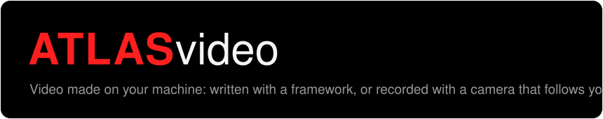
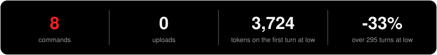

<p align="center"></p>
<p align="center"></p>

**Ask your coding agent for a demo video, and get one, with nothing uploaded.** Everything in [`atlas`](https://github.com/Z0CC0/ATLAS), plus `atlas clip`, which records your screen with a camera that follows the cursor and zooms where you stop or type, and `atlas media`, which directs the video frameworks you have installed.

```
/plugin marketplace add Z0CC0/ATLAS
/plugin install atlas-video@atlas
```

Then, on Windows with `ffmpeg` on the PATH:

```
atlas clip, record 30 seconds of my screen with sounds
```

It tells you what it will capture and waits for a yes. Install one ATLAS build: two side by side inject the rules twice. For coding and the memory too, install [`atlas-max`](https://github.com/Z0CC0/ATLAS-max) instead.

## What it adds

| type this | and it |
|---|---|
| `atlas media` | makes videos, slides and demos with the tools you have installed: HyperFrames first, then Remotion, then Manim. Plans first, renders small before well, checks on-screen text for legibility. Also an HTML slide deck, a Playwright walkthrough of a web app, Blender scene checks by numbers, and the look of reference footage as a grade and a cut |
| `atlas clip` | records the primary screen and renders a video whose camera follows the cursor, with a zoom where you stop or type, and optional click and key sounds |

`atlas media` makes nothing by itself: it directs a framework you install. It says which one it found, and it stops if there is none.

## How `atlas clip` works

```
node tools/clip/src/cli.mjs make demo.mp4 --seconds 30 --countdown 3 --suoni
```

1. **Record.** `ffmpeg` captures the primary screen, while one persistent PowerShell process samples the cursor 60 times a second and writes `<out>.cursor.json`.
2. **Plan.** Where the cursor rested (450-2600 ms, with less than 2% movement) becomes a zoom region, strongest first, at least 1.8 s apart. While you type, the zoom goes to the rectangle of the focused field.
3. **Render.** `ffmpeg` applies the camera path, with a spring that does not overshoot. Sounds are mixed in only with `--suoni`.

**Keys are counted, never identified.** The recorder knows how many keys went down in each sample, for the sound and the zoom. It never knows which, and no text you type is written anywhere by it. The video itself shows whatever is on your screen, so close what should not be seen.

## What it costs

| | `atlas` | `atlas-video` |
|---|---|---|
| names and descriptions, counted, in every session | 824 | 1,053 |
| rules injected at `low`, counted | 1,408 | 1,409 |
| installed and switched off, as billed | 1,238 | 1,601 |
| first turn at `low`, as billed | 3,356 | 3,724 |
| first turn at `high`, as billed | 3,536 | 3,905 |
| a 40-turn session at `low`, against no plugin | -18% | -16% |
| a 295-turn session at `low` | -33% | -33% |
| a 40-turn session at `high` | -27% | -25% |
| a 295-turn session at `high` | -42% | -42% |

Billed on `claude-opus-5-5` at 0.1.0. The session rows assume this build saves per answer what `atlas` saves; that was not measured on this build.

## Advantages of this build

- Video without an account or an upload: everything renders on your machine.
- `atlas clip` has no dependency but `ffmpeg`: about 51 KB of code and 352 KB of sounds.
- Only two descriptions are added to every chat, and the 14 files behind `atlas media` are read when it is used.

## Disadvantages of this build

- `atlas clip` records on Windows only. `plan` and `render` run anywhere, on a recording that already has its trace.
- It records the whole primary screen, with no window or area selection and no editor: to change a zoom you edit the plan file or record again.
- `atlas media` needs a framework you install yourself. HyperFrames made one real 47-second short; Manim, Remotion and Blender were never run, because they were not installed.
- It does not generate video from a prompt. For that see `connections.md`, and read the licences.
- The zoom on the focused field was run on real recordings by its author, not across many apps.

## Connections

Other tools you can attach, with what each one costs: [`connections.md`](connections.md).

## Where it comes from

The camera logic of `atlas clip` is written from the behaviour of [OpenScreen](https://github.com/siddharthvaddem/openscreen) (MIT, © 2025 Siddharth Vaddem, archived on 2026-10-17), read and not copied: dwell detection and spacing, adaptive follow, a per-axis spring with stiffness 320, damping 40 and mass 0.92. Those three spring numbers were read in OpenScreen, and they first appear in [Recordly](https://github.com/webadderallorg/Recordly), commit `0cf009c` of 2026-03-10, then under MIT (© 2026 webadderall). The two projects share early history, and Recordly's current licence is AGPL-3.0 with added terms. No code from Recordly is here, and its feature list was studied. The sounds are rendered with the sound bank of [earshot](https://github.com/Leonxlnx/earshot) (MIT, © 2026 Leon Lin): see `tools/clip/assets/suoni/NOTICE.md`.

## How it compares

`atlas clip` is what we can honestly compare: it is a screen recorder. `atlas media` is a director, not a renderer: HyperFrames and Remotion do the work, so they are its tools rather than its rivals.

Figures from 2026-11-02.

| project | stars | what it is | what we took | runs on | licence |
|---|---|---|---|---|---|
| **`atlas clip`** | | a command for an agent | | Windows | MIT |
| [OpenScreen](https://github.com/siddharthvaddem/openscreen) | 40,019 | desktop app, archived on 2026-10-17 | dwell detection, follow and spring logic, read and rewritten | macOS, Windows, Linux | MIT |
| [Recordly](https://github.com/webadderallorg/Recordly) | 35,898 | desktop app | the spring numbers are first seen here; the feature list was studied, and no code taken | macOS, Windows, Linux | AGPL-3.0 with added terms |
| [OpenMontage](https://github.com/calesthio/OpenMontage) | 75,185 | a production system you work inside | read, nothing taken | Python, Node, FFmpeg | AGPL-3.0 |
| [HyperFrames](https://github.com/heygen-com/hyperframes) | 77,638 | the renderer `atlas media` tries first | ideas for `atlas media` | Node, FFmpeg, Chrome | Apache-2.0 |
| [Remotion](https://github.com/remotion-dev/remotion) | 70,053 | video written in React, its second choice | | Node, Chrome | source-available, paid for larger companies |
| [earshot](https://github.com/Leonxlnx/earshot) | 3,537 | sound for agents | four rendered sounds | Python, ffmpeg | MIT |
| [WanGP](https://github.com/deepbeepmeep/WanGP) | 11,329 | local generation from a prompt | nothing: a connection, not a part | Python, GPU | its own community licence |

**Where `atlas clip` is better**

- **An agent can run it.** A command, with no window to click through. We found no CLI or headless mode in OpenScreen or Recordly.
- **The zoom follows your typing.** It goes to the field you are typing in, and we found nothing like it in OpenScreen or in a weaker search of Recordly. Keys are counted, never identified.
- **It weighs almost nothing:** about 51 KB of code against an Electron app, and it is maintained, while OpenScreen is archived.
- **A licence you can build on:** MIT, against Recordly's AGPL and OpenMontage's AGPL.

**Where they are better, by a long way**

- **As a recorder, OpenScreen and Recordly are simply more.** Window choice, microphone and system audio, webcam, captions, a timeline editor with trim and speed, GIF export, and macOS and Linux. `atlas clip` records the whole primary screen on Windows, with no sound of its own and no editor. If you want to edit a video by hand, use one of those.
- **OpenMontage goes much further:** twelve production pipelines from research to render, generation, voice, stock footage, budget caps and a review of the result. It costs far more in tokens (3,303 plus a 10,687-token guide) and works only inside its own folder.
- **HyperFrames and Remotion make the video.** Without one of them installed, `atlas media` makes nothing. HyperFrames adds about 450 blocks and a studio that are not ours.
- **Generating from a prompt:** WanGP does it, and we do not.

**Not proved:** `atlas media` has made one real short, with HyperFrames, and it was not judged final. Manim, Remotion and Blender were never run through it. `atlas clip` was tried on real recordings by its author, not across many machines.

## Connections

Attach a generator such as WanGP, or another framework, with the advantages, disadvantages and licences of each: [`connections.md`](connections.md). Nothing is installed for you.

---

Part of [ATLAS](https://github.com/Z0CC0/ATLAS), which holds the bench behind every figure here. MIT licence; the sounds keep their notice in `tools/clip/assets/suoni/NOTICE.md`.
